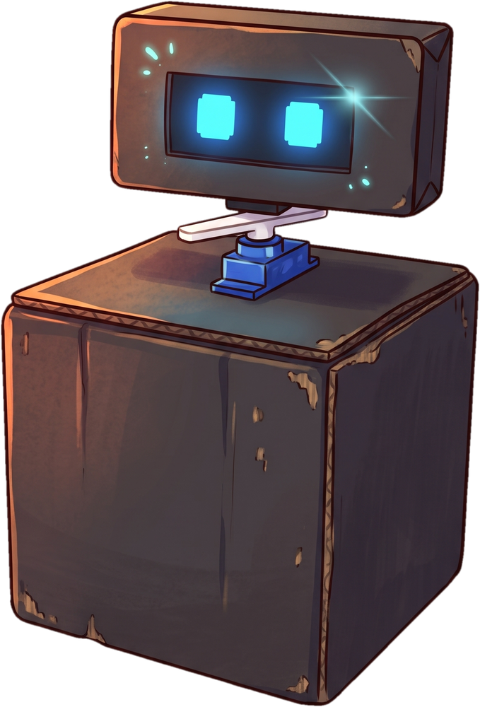
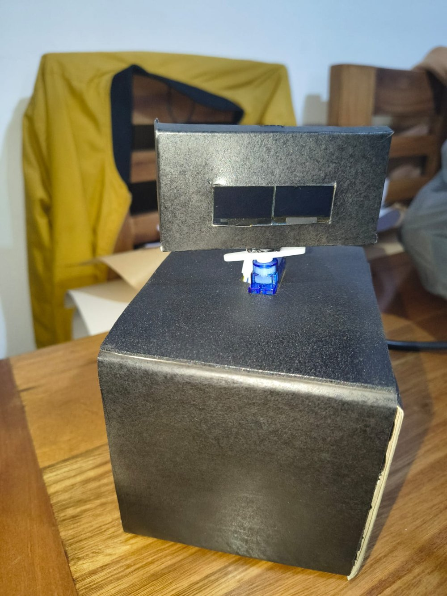
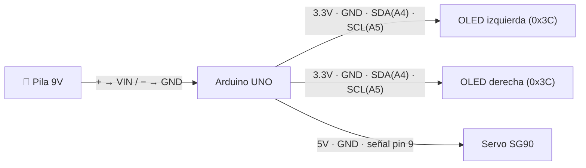
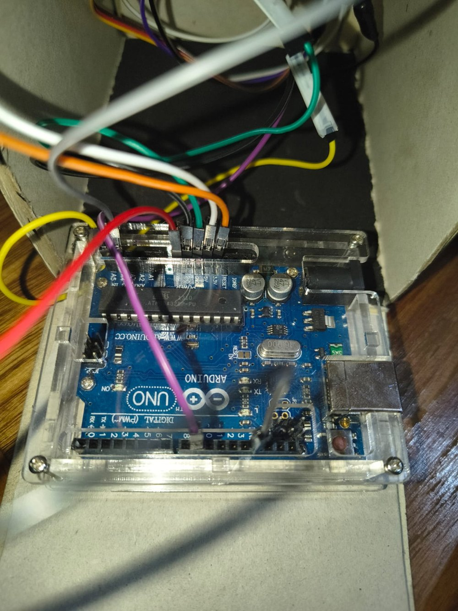
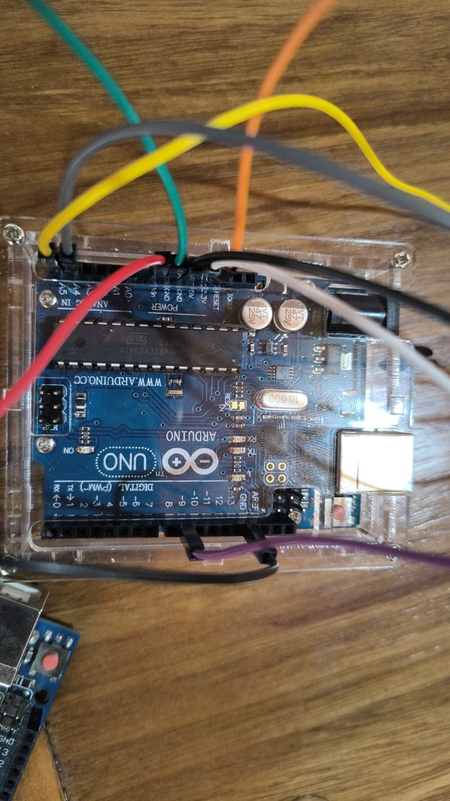
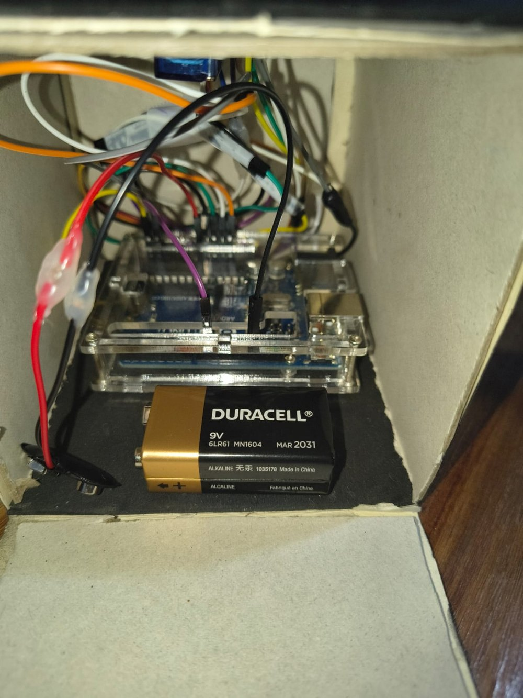
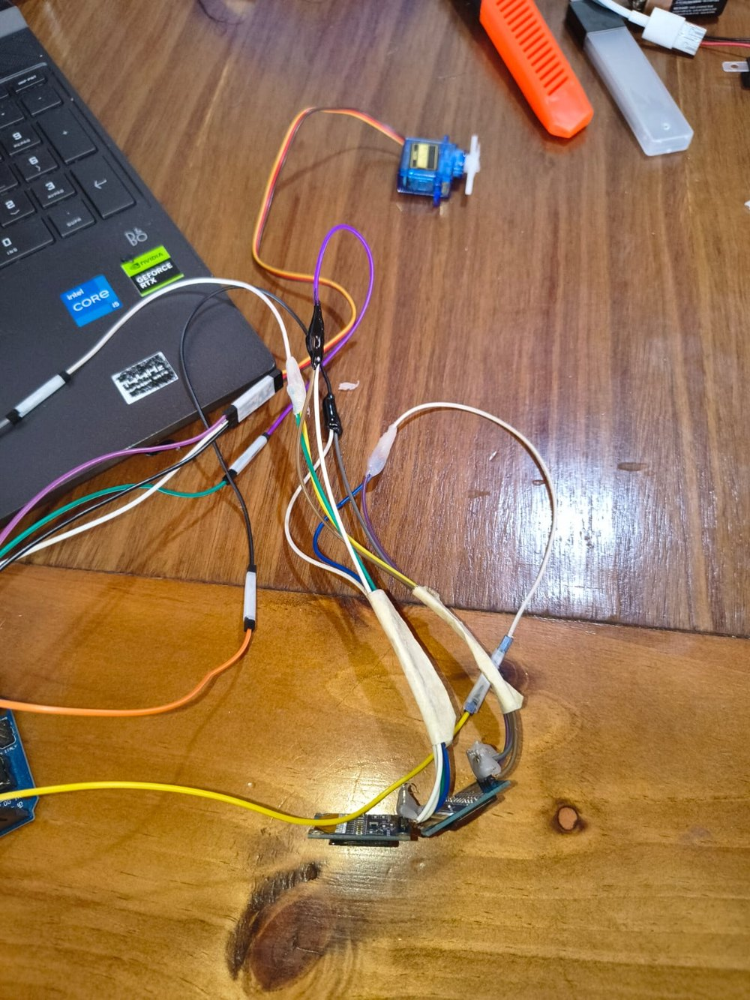

# IRIS 👁️ Mirada expresiva, compañía inteligente

<p align="center">
  
  &nbsp;&nbsp;&nbsp;
  
</p>

**IRIS** es un robot de escritorio con ojos animados y movimiento sincronizado. Dos pantallas OLED hacen de ojos: parpadean, miran hacia los lados, se ponen felices, se sorprenden y hasta se quedan dormidos, mientras un servomotor gira su cabeza en la misma dirección en la que mira.

Todo funciona con **un Arduino UNO y una pila de 9V**, sin cables a la pared ni al computador. No tiene una misión fija: es un compañero para lo que cada persona decida.

> Proyecto del ramo **Internet de las Cosas** · Santo Tomás · Docente: Gustavo Honorato.

---

## 📑 Contenido

1. [¿Qué hace IRIS?](#-qué-hace-iris)
2. [Materiales](#-materiales)
3. [Conexiones](#-conexiones)
4. [Armado paso a paso](#-armado-paso-a-paso)
5. [Cómo cargar el código](#-cómo-cargar-el-código)
6. [Cómo funciona el código](#-cómo-funciona-el-código)
7. [Personalízalo](#-personalízalo)
8. [Problemas frecuentes](#-problemas-frecuentes)
9. [Historia del proyecto](#-historia-del-proyecto)
10. [Próxima etapa](#-próxima-etapa)
11. [Documentación del proyecto](#-documentación-del-proyecto)
12. [Equipo](#-equipo)

---

## ✨ ¿Qué hace IRIS?

| Función | Qué ocurre |
|---|---|
| **Seguimiento visual** | Cuando la cabeza gira, los ojos se desplazan hacia el mismo lado (hasta 14 píxeles), así la mirada acompaña al movimiento. |
| **Expresiones vivas** | Mirada atenta en reposo, parpadeo fluido (a veces doble), sonrisa feliz con rebotes, sorpresa con pupila y sueño con “z Z”. |
| **Cuello articulado** | Un servo gira la cabeza a la izquierda (60°), al centro (90°) y a la derecha (120°), avanzando de a 1° cada 12 ms para que se vea suave. |
| **Comportamiento autónomo** | Descansa entre 1,5 y 3,5 segundos, elige una acción al azar y nunca repite la misma dos veces seguidas. |
| **Autonomía** | Funciona con una pila de 9V conectada al Arduino. |

> 💡 **Sobre los grados:** el servo SG90 puede llegar hasta unos 180°. En este programa se usa entre 60° y 120° porque se ve más natural, pero puedes cambiarlo en las constantes `IZQUIERDA` y `DERECHA` (ver [Personalízalo](#-personalízalo)).

---

## 🧰 Materiales

| Cantidad | Material | Para qué sirve |
|:---:|---|---|
| 1 | **Arduino UNO** (ATmega328P) | El cerebro: ejecuta el programa y controla ojos y cuello. |
| 2 | **Pantallas OLED SSD1306** 128x64, I2C (dirección `0x3C`) | Los ojos del robot. |
| 1 | **Micro servo SG90** | Gira la cabeza. |
| 1 | **Pila alcalina de 9V** con conector | Alimentación autónoma (entra por el pin `VIN`). |
| 1 | Base acrílica transparente para Arduino *(opcional)* | Sostiene y protege la placa. |
| — | Cables Dupont (macho-hembra) y cables de extensión | Conectan todo. |
| 2 | Cajas de cartón | Cuerpo y cabeza del robot. |
| — | Pintura negra, cinta de papel | Acabado y refuerzo de la carcasa. |
| 1 | Soldador y estaño *(opcional)* | Asegurar las conexiones que se sueltan con el movimiento. |
| 1 | Cable USB tipo B | Para cargar el programa desde el computador. |

**Software:** [Arduino IDE](https://www.arduino.cc/en/software) y las librerías **Adafruit GFX Library** y **Adafruit SSD1306** (las otras dos, `Wire` y `Servo`, ya vienen con el IDE).

---

## 🔌 Conexiones

### Tabla de conexiones

| Componente | Cable / pin del módulo | Pin en Arduino UNO | Notas |
|---|---|---|---|
| **OLED izquierda** (`0x3C`) | VCC / VDD | **3.3V** | Alimentación compartida. |
| | GND | **GND** | Tierra común. |
| | SDA | **A4** | Bus I2C (datos). |
| | SCL / SCK | **A5** | Bus I2C (reloj). |
| **OLED derecha** (`0x3C`) | VCC / VDD | **3.3V** | Va unido al mismo pin 3.3V que la izquierda. |
| | GND | **GND** | Tierra común. |
| | SDA | **A4** | Va unido en paralelo al mismo pin A4. |
| | SCL / SCK | **A5** | Va unido en paralelo al mismo pin A5. |
| **Servo SG90** | Positivo (VCC, cable rojo) | **5V** | Alimentación para el giro del motor. |
| | Negativo (GND, cable marrón) | **GND** | Tierra común. |
| | Señal (cable naranja) | **~9** | Pin PWM que controla el ángulo. |
| **Pila de 9V** | Positivo (+, rojo) | **VIN** | Entrada de voltaje regulado de la placa. |
| | Negativo (−, negro) | **GND** | Tierra común con todo el circuito. |

### Diagrama



### Cosas importantes de este circuito

- **Las dos pantallas comparten pines.** Van conectadas en paralelo a `A4` y `A5`. Como las dos tienen la misma dirección (`0x3C`), reciben exactamente los mismos datos, por eso **los dos ojos siempre muestran lo mismo**.
- **La pila entra por `VIN`.** El Arduino la regula y reparte: de ahí salen los 5V del servo y los 3.3V de las pantallas.
- **Todos los negativos van a la misma tierra (`GND`).** Si falta alguno, el circuito se comporta de forma rara.

<p align="center">
  
  &nbsp;
  
</p>

---

## 🛠️ Armado paso a paso

### Paso 1 · Reúne los materiales y prueba cada pieza
Antes de unir nada, revisa que cada componente funcione por separado. Las pantallas OLED tienen solo cuatro pines (`GND`, `VCC`, `SCL`, `SDA`), así que las dos se conectan a los mismos pines del Arduino.

### Paso 2 · Instala el entorno
1. Instala el [Arduino IDE](https://www.arduino.cc/en/software).
2. Ve a **Herramientas → Administrar bibliotecas…** e instala **Adafruit GFX Library** y **Adafruit SSD1306** (acepta instalar sus dependencias).

### Paso 3 · Arma el circuito en la mesa
Hazlo primero **sin carcasa**, con el cable USB conectado, para poder probar:
1. Conecta **GND** de las dos pantallas y del servo a un pin `GND` del Arduino.
2. Conecta **VCC** de las dos pantallas al pin **3.3V**.
3. Conecta **SDA** de las dos pantallas a **A4** y **SCL** a **A5**.
4. Conecta el cable **rojo** del servo a **5V**, el **marrón** a `GND` y el **naranja** al pin **9**.

### Paso 4 · Carga el programa y pruébalo
Sigue la sección [Cómo cargar el código](#-cómo-cargar-el-código). Si las dos pantallas muestran los ojos y el servo mueve la cabeza, el circuito está bien.

### Paso 5 · Conecta la pila de 9V
Desconecta el USB y conecta el **positivo** de la pila a `VIN` y el **negativo** a `GND`. IRIS debería funcionar igual, ahora de forma autónoma.

### Paso 6 · Construye la carcasa
1. Usa **una caja para el cuerpo y otra para la cabeza**.
2. En la cabeza, corta una **ventana rectangular** por donde se asoman las dos pantallas.
3. Fija el servo en la parte de arriba del cuerpo; la cabeza se apoya sobre él.
4. Deja una **abertura trasera** para el paso de cables y para poder acceder al interior.
5. Refuerza las uniones con cinta de papel y pinta todo de **negro**.

### Paso 7 · Asegura el cableado
Con el movimiento del servo, algunas conexiones se sueltan. Alarga con cables de extensión los que queden cortos, protege las uniones con cinta y **suelda** los puntos que más se mueven.

### Paso 8 · Montaje final
Pon el Arduino (sobre su base acrílica) dentro del cuerpo, con la pila de 9V justo debajo, conectada a `VIN` y `GND`. Cierra, conecta la pila y ¡IRIS cobra vida!

<p align="center">
  
  &nbsp;
  
</p>

---

## ⬆️ Cómo cargar el código

1. Descarga o clona este repositorio:
   ```bash
   git clone https://github.com/MinionVIP/IRIS.git
   ```
2. Abre el archivo [`iris/iris.ino`](iris/iris.ino) con el Arduino IDE.
3. Elige la placa en **Herramientas → Placa → Arduino UNO**.
4. Elige el puerto en **Herramientas → Puerto**.
5. Presiona **Subir** (➡️). Al terminar, los ojos deberían aparecer en las pantallas.

> ⚠️ El archivo debe quedar dentro de una carpeta con el mismo nombre (`iris/iris.ino`), como está en este repositorio; si no, el IDE se queja.

---

## 🧠 Cómo funciona el código

Todo el programa está en un solo archivo: [`iris/iris.ino`](iris/iris.ino). Los ojos **no son imágenes**: se dibujan con formas geométricas (rectángulos redondeados y círculos), lo que permite animarlos con mucha suavidad.

### Constantes que puedes ajustar

| Constante | Valor | Qué controla |
|---|:---:|---|
| `DIRECCION_OLED` | `0x3C` | Dirección I2C de las pantallas. |
| `PIN_SERVO` | `9` | Pin de señal del servo. |
| `CENTRO` / `IZQUIERDA` / `DERECHA` | `90` / `60` / `120` | Ángulos del cuello, en grados. |
| `PASO_SERVO_MS` | `12` | Milisegundos entre cada grado de giro (más alto = más lento). |
| `MIRADA_MAX` | `14` | Píxeles máximos que se desplazan los ojos al girar. |
| `OJO_ANCHO` / `OJO_ALTO` | `44` | Tamaño del ojo en píxeles. |
| `OJO_RADIO` | `10` | Redondeo de las esquinas del ojo. |

### Las funciones, una por una

| Función | Qué hace |
|---|---|
| `desplazamientoMirada()` | Convierte el ángulo actual del cuello (60°–120°) en un desplazamiento de los ojos (−14 a +14 píxeles). Así los ojos acompañan al giro. |
| `dibujarOjo(ancho, alto, desplazamiento)` | Dibuja un ojo: un rectángulo con las esquinas redondeadas, centrado en la pantalla y corrido según el desplazamiento. |
| `mostrarOjo(ancho, alto, desplazamiento)` | Limpia la pantalla, dibuja el ojo y lo muestra. Es la “imagen base” que usan casi todas las demás funciones. |
| `parpadear()` | Reduce la altura del ojo hasta casi cerrarlo y lo vuelve a abrir rápido. Mantiene la posición de la mirada. |
| `moverCuello(destino)` | Conecta el servo, lo mueve **de a 1° cada 12 ms** hasta el ángulo de destino, redibuja los ojos en cada paso (mirada sincronizada) y luego **desconecta el servo** para que no quede temblando ni gastando energía. |
| `dibujarFeliz(dy)` | Dibuja un arco de alegría (un círculo al que se le recorta la parte de abajo), subido o bajado `dy` píxeles. |
| `feliz()` | Anima el arco con rebotes hacia arriba y abajo, espera un segundo y vuelve a los ojos normales. |
| `dibujarSorpresa(tam)` | Dibuja un ojo cuadrado de tamaño `tam` con una pupila negra al centro. |
| `sorpresa()` | Agranda el ojo de golpe (de 44 a 56 px), espera 1,3 s y lo devuelve a su tamaño. |
| `dibujarSueno(alto, zetas)` | Dibuja el ojo con la altura indicada y agrega una “z” pequeña y/o una “Z” más grande. |
| `sueno()` | Cierra el ojo poco a poco, hace aparecer las letras z y Z, lo deja como una línea, y luego “despierta” al robot con un parpadeo. |
| `mirarLado(destino)` | Gira el cuello hacia un lado, mantiene la mirada entre 0,9 y 1,8 s (con 40 % de probabilidad de parpadear) y vuelve al centro. |
| `reposo(ms)` | Muestra los ojos quietos durante `ms` milisegundos, parpadea y, con 25 % de probabilidad, parpadea otra vez. |
| `setup()` | Inicia el bus I2C y las pantallas (si no responden, el programa se detiene), prepara el generador de números al azar con el ruido del pin `A0`, centra el cuello y muestra los ojos. |
| `loop()` | El “carácter” de IRIS: descansa 1,5–3,5 s, elige una acción con pesos, la ejecuta y vuelve a empezar. |

### ¿Cómo elige qué hacer?

En `loop()` hay una lista de pesos: `{0, 0, 1, 1, 2, 3, 4}`. Cada número es una acción y los que se repiten tienen más probabilidad:

| Acción | Número | Veces en la lista | Frecuencia aprox. |
|---|:---:|:---:|:---:|
| Mirar a la izquierda | 0 | 2 | ~29 % |
| Mirar a la derecha | 1 | 2 | ~29 % |
| Ponerse feliz | 2 | 1 | ~14 % |
| Sorprenderse | 3 | 1 | ~14 % |
| Dormirse | 4 | 1 | ~14 % |

Además, el programa **evita repetir la misma acción dos veces seguidas**, así IRIS siempre se ve espontáneo.

---

## 🎛️ Personalízalo

- **Que mire más lejos:** sube `IZQUIERDA` y baja `DERECHA` en el código, por ejemplo `30` y `150`. Si cambias esos valores, `desplazamientoMirada()` se ajusta solo.
- **Movimientos más lentos o más rápidos:** cambia `PASO_SERVO_MS`.
- **Ojos más grandes o más chicos:** cambia `OJO_ANCHO` y `OJO_ALTO`.
- **Que se duerma más seguido:** agrega más `4` a la lista `pesos` en `loop()`.
- **Crear una expresión nueva:** copia el patrón de `feliz()` o `sorpresa()` (una función que dibuja y otra que anima), súmala al `switch` de `loop()` con un número nuevo y agrégala a `pesos`.

---

## 🩺 Problemas frecuentes

| Problema | Qué revisar |
|---|---|
| **Las pantallas no encienden** | Revisa `VCC`, `GND`, `SDA` (A4) y `SCL` (A5). Si tus pantallas usan otra dirección, cambia `DIRECCION_OLED` (suele ser `0x3C` o `0x3D`). |
| **El programa se queda “congelado” al encender** | Es el `for (;;);` de `setup()`: significa que las pantallas no respondieron. Revisa las conexiones. |
| **El servo vibra o hace ruido** | Revisa que el `GND` del servo esté unido al `GND` del Arduino y que el cable de señal esté en el pin 9. |
| **El robot se reinicia cuando mueve el cuello** | Pila baja o conexiones flojas. Cambia la pila y revisa las uniones (idealmente soldadas). |
| **Los ojos van al revés del giro** | Intercambia los valores de `IZQUIERDA` y `DERECHA`, o dale la vuelta al signo en `desplazamientoMirada()`. |
| **Una conexión se suelta con el movimiento** | Refuerza con cinta o suelda ese punto. |

---

## 📖 Historia del proyecto

El proyecto tuvo tres nombres: empezó como **PomoBot** (un asistente de estudio con método Pomodoro), pasó por **CronoBot** y terminó como **IRIS**, ya no solo para estudiar, sino para lo que cada persona decida.

También tuvo un **cambio de prototipo completo**. La primera versión usaba una placa **ESP32**, pero no estaba enviando corriente a los demás dispositivos conectados (pantallas y servo), así que el robot no podía funcionar. La reemplazamos por un **Arduino UNO con pila de 9V** y simplificamos el diseño: quedaron un microcontrolador, dos pantallas y un servo. El sensor ultrasónico, el display de 7 segmentos, el botón y el buzzer de la versión anterior quedaron fuera por ahora.

Otro cambio: la carcasa estaba pensada para imprimirse en 3D, pero la impresora no funcionó a tiempo, así que la reemplazamos por **cajas de cartón pintadas de negro a mano**.

---

## 🚀 Próxima etapa

**Temporizador Pomodoro e IA**

1. **Ciclos 25/5:** estudio y descanso guiados.
2. **Pantalla de tiempo:** cuenta regresiva a la vista.
3. **Alertas sonoras:** avisos al cambiar de ciclo.
4. **Recordatorios con IA:** mensajes inteligentes directos desde IRIS.

---

## 📂 Documentación del proyecto

```
IRIS/
├── README.md                ← este archivo
├── iris/
│   └── iris.ino             ← código del robot (Arduino IDE)
├── imagenes/                ← fotos e ilustración
└── docs/
    ├── IRIS_Informe.docx    ← informe completo del proyecto
    ├── IRIS_Afiche.pdf      ← afiche para la feria
    └── IRIS_Triptico.pdf    ← tríptico
```

---

## 👥 Equipo

**Docente:** Gustavo Honorato

**Integrantes:** Ana Belén Campos · María Soledad Martínez · Juan Pablo Cantillano · Diego Garay · John Rivera

*Proyecto Internet de las Cosas · Santo Tomás · GitHub: [MinionVIP](https://github.com/MinionVIP)*
